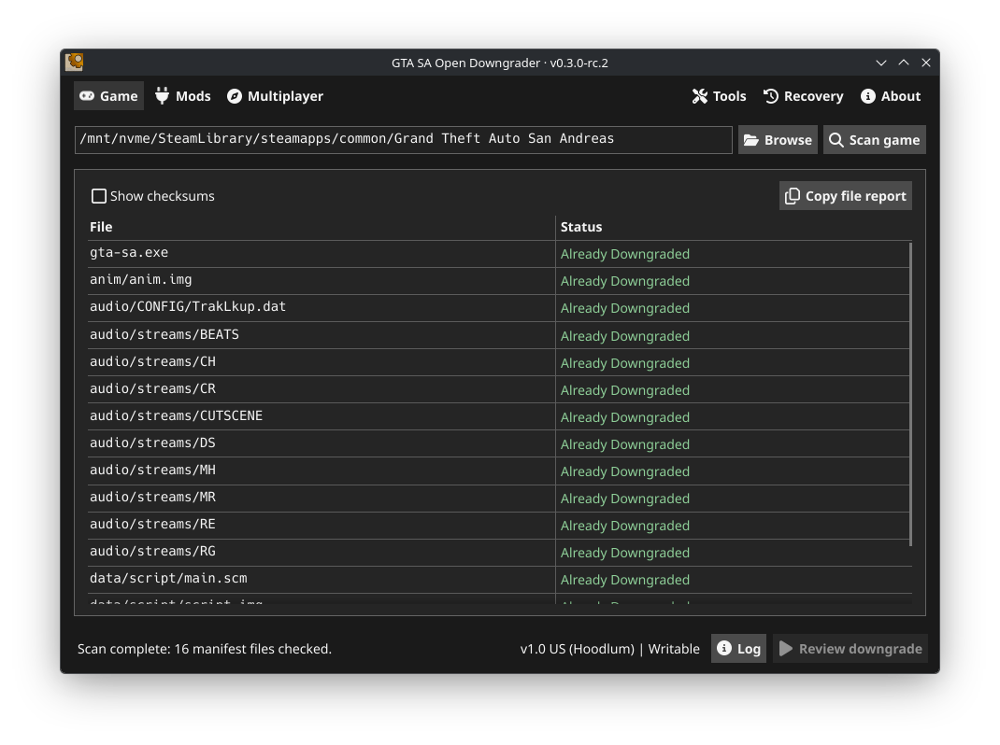
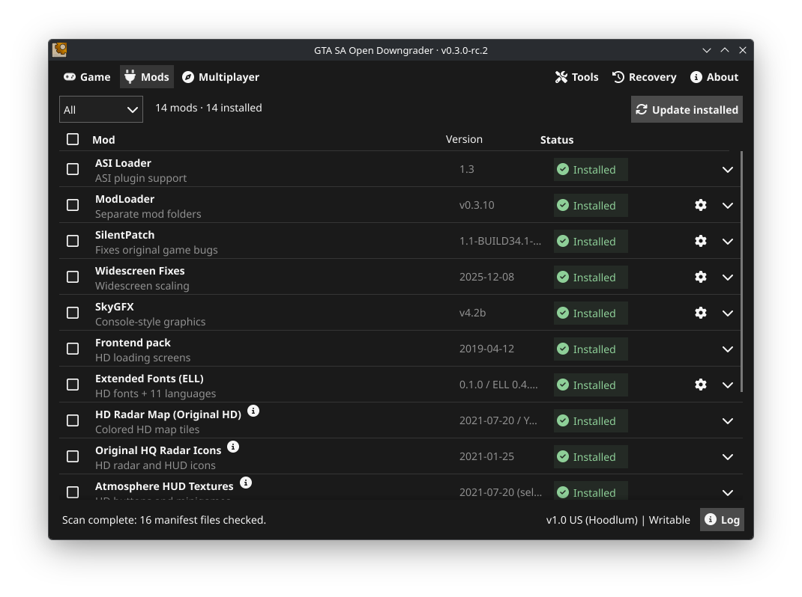
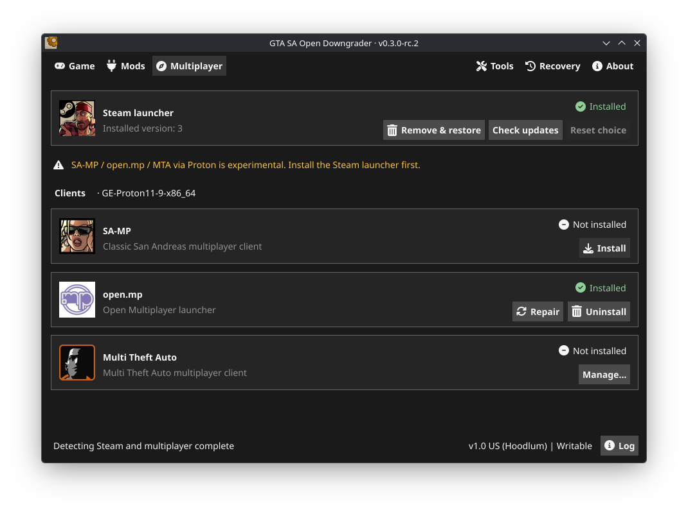
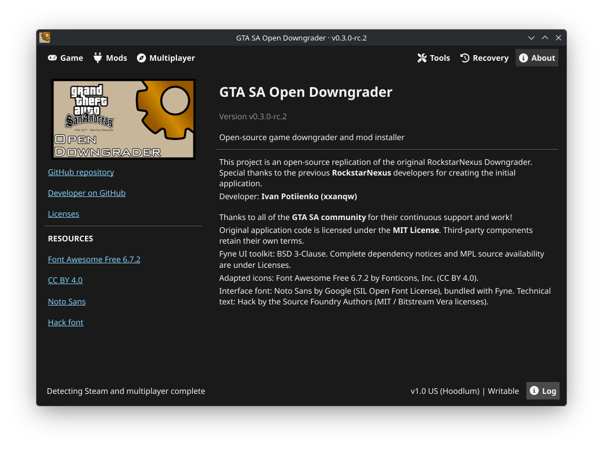

# GTA SA Open Downgrader

Downgrade GTA San Andreas, install community fixes, and manage multiplayer clients on Windows and Linux.

**Supported:** NewSteam R2 Global and German → v1.0 US (Hoodlum). Other detected editions are not supported downgrade sources.

## Download

**[Get v0.3.0](https://github.com/xxanqw/gtasa-open-downgrader/releases/latest)** · [Release notes](docs/releases/v0.3.0.md) · [Steam launcher v4](https://github.com/xxanqw/gtasa-open-downgrader/releases/tag/launcher-4)

| Platform | Online | Offline |
| --- | --- | --- |
| Windows x64 | `gtasa-open-downgrader-windows.exe` | `gtasa-open-downgrader-windows-offline.exe` |
| Linux x64 | `gtasa-open-downgrader-linux.AppImage` | `gtasa-open-downgrader-linux-offline.AppImage` |

Offline builds include patches. Mods, multiplayer clients, and updates still need internet access.

## Quick start

1. Close GTA and back up customized files and saves.
2. Choose the game folder and install or import patches if prompted.
3. Review the downgrade, apply it, and let verification finish.
4. Open **Mods** or **Multiplayer** to set up your game.

On Linux, make the AppImage executable before opening it. If FUSE is unavailable, launch with `--appimage-extract-and-run`.

Originals are kept in `backups/`. **Recovery** can restore them; cancelling an operation does not undo completed changes. ShareMods downloads require manual confirmation in your browser. Linux multiplayer support is experimental.

## Screenshots

<table>
  <tr>
    <td width="50%"></td>
    <td width="50%"></td>
  </tr>
  <tr>
    <td width="50%"></td>
    <td width="50%"></td>
  </tr>
</table>

## Guides

- [Usage, mods, multiplayer, and recovery](docs/usage.md)
- [Troubleshooting and sharing logs](docs/troubleshooting.md)
- [Build from source](docs/development.md)
- [Publishing releases](docs/releasing.md)

Found a problem? Choose **Log → I'm creating an issue on GitHub**, or [open an issue](https://github.com/xxanqw/gtasa-open-downgrader/issues).

The previous Python release is preserved on the [`v0.2.3` branch](https://github.com/xxanqw/gtasa-open-downgrader/tree/v0.2.3).

## License

Original code is licensed under [MIT](LICENSE). Third-party components retain their own terms; see [notices and source availability](internal/licenses/NOTICES.txt) and [distribution qualifications](internal/licenses/scope.txt), also available through **About → Licenses**.

## Star History

<a href="https://www.star-history.com/?repos=xxanqw%2Fgtasa-open-downgrader&type=timeline&logscale=&releases=&legend=bottom-right">
 <picture>
   <source media="(prefers-color-scheme: dark)" srcset="https://api.star-history.com/chart?repos=xxanqw/gtasa-open-downgrader&type=timeline&theme=dark&legend=bottom-right" />
   <source media="(prefers-color-scheme: light)" srcset="https://api.star-history.com/chart?repos=xxanqw/gtasa-open-downgrader&type=timeline&legend=bottom-right" />
   
 </picture>
</a>
